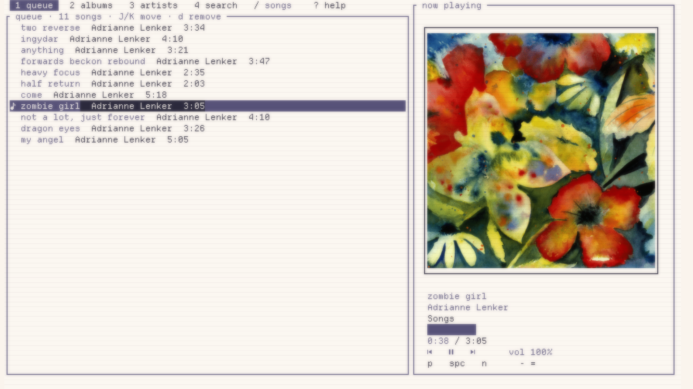
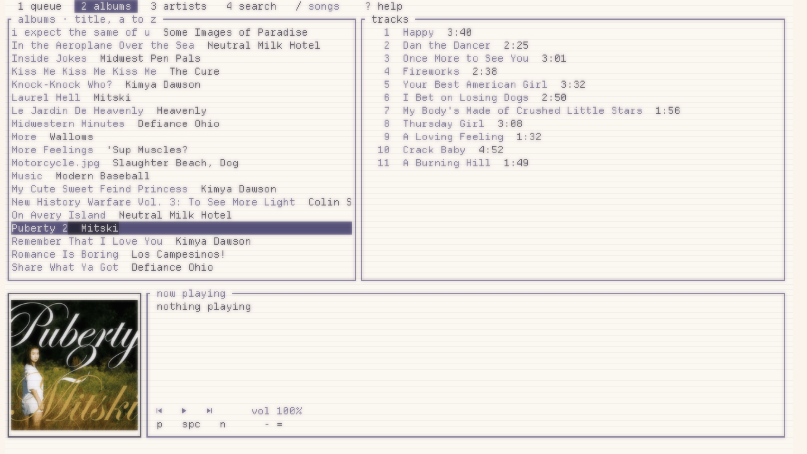
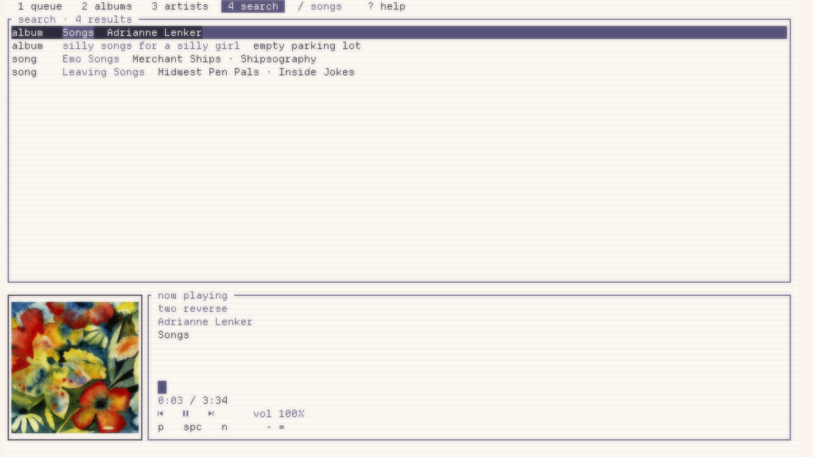
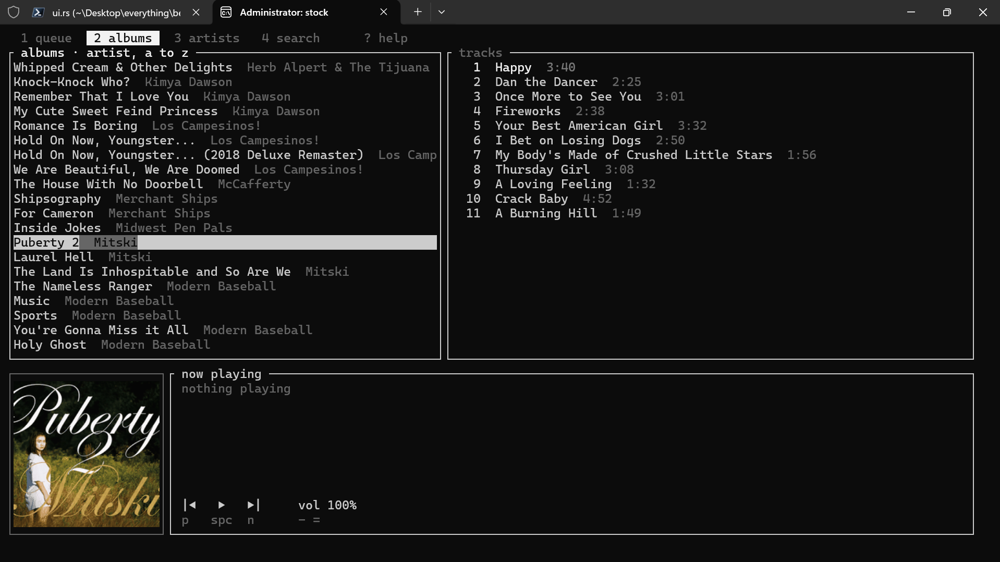

# berry

A small, fast music player for the terminal, with album art.

berry plays your local music library inside Windows Terminal: browse by album or artist, search as you type, build a queue, and see real album covers right in the terminal. It's a single executable of a few megabytes with no dependencies to install, and it remembers your library between launches so it opens almost instantly.

<br clear="left">

## Features

- Album covers drawn in the terminal (via Sixel), previewed as you browse
- Albums, artists, and search tabs, plus a queue you can reorder
- Live search across artists, albums, and songs
- Sorting by title, artist, year, or recently added, remembered between launches
- Follows your headphones: switch audio devices and playback moves over on its own
- Lyrics from your files' tags, or synced .lrc files
- Plays MP3, FLAC, Opus, OGG, M4A/AAC, WAV, and AIFF
- Keyboard driven, with Vim-style keys
- Uses your terminal's colors, so it matches whatever theme you run
- Playlists, saved as .m3u files in your music folder so other players can read them too

## Requirements

- Windows 10 or 11
- **Windows Terminal 1.22 or newer.** That's the version that added Sixel image support; on older versions berry still works, just without covers.
- That's it. berry works with any font. If your terminal uses a [Nerd Font](https://www.nerdfonts.com/), you can swap the playback controls for its nicer icons with `:icons nerd` (see Commands).
## Install

**With Scoop:**

scoop bucket add berry https://github.com/shalap-pandotra/scoop-berry
scoop install berry


**Or download it:** grab `berry.exe` from the [latest release](../../releases/latest), then run `berry --install` from wherever you saved it. That copies berry to `%LOCALAPPDATA%\Programs\berry` and adds it to your PATH, so `berry` works from any new terminal (`berry --uninstall` undoes it). Or just run it from anywhere without installing.

Windows may show a SmartScreen warning the first time, since the exe isn't signed. Choose "More info" and then "Run anyway".

**From source:** install [Rust](https://rustup.rs) (including the Visual Studio C++ Build Tools it offers during setup) and [CMake](https://cmake.org/download/), then:

```
cargo install --git https://github.com/shalap-pandotra/berry-player
```

## Usage

```
berry                      # plays from your Music folder
berry "D:\Music"           # or any folder you point it at
```

berry scans the folder (subfolders included) and groups songs into albums by their tags. Songs without tags still show up, named after the file and grouped by folder. Covers come from art embedded in the files, or a `cover.jpg` / `folder.jpg` next to them.

The first launch reads every file; after that berry only rereads files that are new or changed, so it opens fast. The cache lives at `%LOCALAPPDATA%\berry\library.db`, and it's safe to delete if you ever want a fresh scan.

## Screenshots

<p align="center">
</p>

<p align="center"></p>
<p align="center"></p>

the screenshots above come from a my terminal which uses a custom theme. if you run berry in just a stock windows terminal, this is what it looks like. it just picks up whatever colors your terminal uses.

<p align="center"></p>

## Keys

Press `?` inside berry to see these at any time.

| Key | Does |
| --- | --- |
| `enter` | play now |
| `a` / `A` | add to queue / add the whole album or artist |
| `space` | pause / resume |
| `n` / `p` | next / previous |
| `,` / `.` | seek back / forward 5 seconds |
| `-` / `=` | volume down / up |
| `L` | lyrics (`j`/`k` scroll, `q` closes) |
| `1` to `5` | jump to a tab |
| `s` | add to playlist |
| `r` | rename playlist |
| `tab` / `shift+tab` | next / previous tab |
| `` ` `` | back to the last tab |
| `j` / `k` | down / up |
| `h` / `l` | left / right column |
| `/` | search |
| `o` | sort the list you're on |
| `:` | command line (see below) |
| `J` / `K` | move a song in the queue |
| `d` / `D` | remove a song / clear the queue |
| `q` | quit |

## Commands

Press `:` to open the command line. Tab completes, Up and Down bring back earlier commands, and any unambiguous start works (`:vol`, `:shuf`).

| Command | Does |
| --- | --- |
| `:volume 60` | set the volume (0 to 150) |
| `:seek 1:30` | jump to a time in the song |
| `:shuffle` | shuffle the queue (the current song keeps playing); again to put the original order back |
| `:repeat` | cycle repeat: off, the whole queue, one song (or `:repeat all`) |
| `:clear` | clear the queue |
| `:folder D:\Music` | switch to another music folder; berry opens it next time too |
| `:rescan` | reread the current folder |
| `:icons nerd` | use Nerd Font icons for the playback controls (`:icons plain` to switch back) |
| `:save mix` | save current queue as playlist |
| `:help` | show the keys |
| `:q` | quit |
| `:lyrics` | show or hide the lyrics |

berry remembers your sorts, your music folder, and your icon choice between launches.

## Troubleshooting

If berry closes unexpectedly, run it with `BERRY_DEBUG` set to see the error:

```
$env:BERRY_DEBUG=1; berry
```
